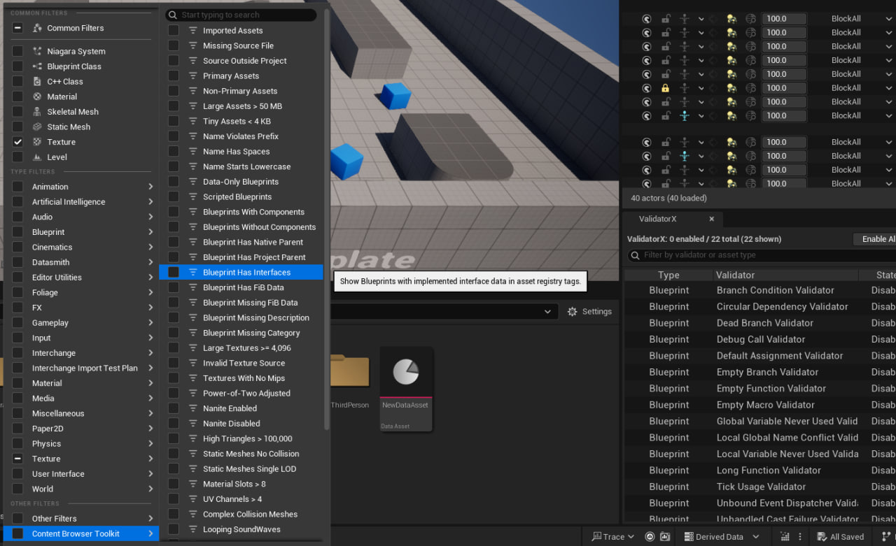

# Content Browser Toolkit

Content Browser Toolkit adds filters and read-only reports to the Unreal Editor Content Browser. Use it to trace references, review a folder before moving it, or compare the settings of selected assets.

## Getting started

This source plugin has been verified with **Unreal Engine 5.5**. It runs in the editor.

1. Copy the `ContentBrowserToolkit` folder into your project's `Plugins` directory so the descriptor is at `Plugins/ContentBrowserToolkit/ContentBrowserToolkit.uplugin`.
2. Build the project editor target, then open the project. Enable **Content Browser Toolkit** in **Edit > Plugins** if needed and restart the editor when prompted.
3. Right-click an asset or folder and open the **Content Browser Toolkit** submenu. In a mixed asset selection, each report uses the asset types it supports.

For quick triage, open **Filters > Content Browser Toolkit**. Examples include **Missing Source File**, **Data-Only Blueprints**, **Textures With No Mips**, **Static Meshes No Collision** and **Audit: References Plugin**. Filters based on Asset Registry tags depend on the metadata available for each asset.

## Common workflows

| Goal | Steps |
| --- | --- |
| Find why a map uses a texture | Run **Show Usage Chains...** on the texture and select a row to read the map-to-package chain. For a deeper scan of a particular level, use **Asset Audit to Map...** and select that map. |
| Plan a folder move | Run **Folder Migration Preview...**, choose the destination, and review **Destination conflict**, **External dependency**, and **External referencer** rows before moving assets. |
| Review a possible duplicate | Run **Find Exact Texture Duplicates...** on a 2D texture. Compare sRGB, compression, and mip settings, then run **Show Usage Chains...** on the candidate before choosing a replacement. |
| Review a material change | Run **Find Material Instances...** on the parent. Select the instances you want to compare and run **Compare Instance Overrides...** to see which values they inherit or override. |
| Check imported content | Run **Check Texture Sets...** on a member of a texture set, **Mesh Setup Audit...** on static meshes, or **Audio Import Audit...** on sound waves. Run **Folder Naming Audit...** to check naming across the whole folder. |

## Content Browser filters

Open **Filters → Content Browser Toolkit**. Hover over a filter's menu entry to see its tooltip. Most filters read saved Asset Registry tags or Content Browser item attributes. The menu replaces `{0}` with the threshold from **Project Settings → Plugins → Content Browser Toolkit**.

### Import and asset management

| Filter | Matches |
| --- | --- |
| Imported Assets | Assets with non-empty source-file import metadata. |
| Missing Source File | Assets with at least one recorded source file that cannot be found on disk. |
| Source Outside Project | Assets with at least one recorded source file outside the project directory. |
| Primary Assets | Assets with a valid Primary Asset ID. |
| Non-Primary Assets | Assets without a valid Primary Asset ID. |

### Size and naming

| Filter | Matches |
| --- | --- |
| Large Assets > {0} MB | Assets with a known on-disk size at or above the configured threshold. |
| Tiny Assets < {0} KB | Assets with a known, positive on-disk size at or below the configured threshold. |
| Name Violates Prefix | Assets of supported classes whose names lack the built-in prefix, including its capitalization. |
| Name Has Spaces | Assets whose object names contain whitespace. |
| Name Starts Lowercase | Assets whose object names start with a lowercase ASCII letter. |

The two disk-size filters include assets exactly at the cutoff. Use **Folder Naming Audit...** to apply the project's configured prefixes.

### Blueprints

| Filter | Matches |
| --- | --- |
| Data-Only Blueprints | Blueprints whose saved data-only tag is true. |
| Scripted Blueprints | Blueprints whose saved data-only tag is false. |
| Blueprints With Components | Assets with a positive Blueprint-owned component count in the registry. |
| Blueprints Without Components | Blueprints whose registry component count is zero. A missing count is treated as zero. |
| Blueprint Has Native Parent | Blueprints with a recorded native parent class path. |
| Blueprint Has Project Parent | Blueprints whose immediate parent class path points into `/Game/`. |
| Blueprint Has Interfaces | Blueprints whose registry metadata lists implemented interfaces. |
| Blueprint Has FiB Data | Blueprints with saved Find in Blueprints search data. |
| Blueprint Missing FiB Data | Blueprints without saved Find in Blueprints search data. |
| Blueprint Missing Description | Blueprints with a missing or empty description tag. |
| Blueprint Missing Category | Blueprints with a missing or empty category tag. |

### Textures

| Filter | Matches |
| --- | --- |
| Large Textures >= {0} | Textures whose saved `MaxTextureSize` is at or above the configured threshold. This checks the size setting. |
| Invalid Texture Source | Textures whose saved `IsSourceValid` tag is false. |
| Textures With No Mips | Textures whose saved mip generation setting specifies `NoMipmaps`. |
| Power-of-Two Adjusted | Textures with a recorded power-of-two adjustment mode other than `None`. |

### Static meshes

| Filter | Matches |
| --- | --- |
| Nanite Enabled | Static meshes whose saved Nanite flag is true. |
| Nanite Disabled | Static meshes whose saved Nanite flag is false. |
| High Triangles > {0} | Static meshes whose recorded triangle count exceeds the configured threshold. |
| Static Meshes No Collision | Static meshes with both zero recorded collision primitives and zero recorded sections with collision. |
| Static Meshes Single LOD | Static meshes with a recorded LOD count of zero or one. |
| Material Slots > {0} | Static meshes whose recorded material slot count exceeds the configured threshold. |
| UV Channels > {0} | Static meshes whose recorded UV channel count exceeds the configured threshold. |
| Complex Collision Meshes | Static meshes whose saved collision complexity specifies `UseComplexAsSimple`. |

### Sound waves

| Filter | Matches |
| --- | --- |
| Looping SoundWaves | Sound waves with looping enabled in the saved metadata. |
| Multichannel SoundWaves | Sound waves with more than two recorded channels. |
| Low Sample Rate SoundWaves | Sound waves with a recorded sample rate greater than zero and at most 22,050 Hz. |
| Audio Quality <= {0} | Sound waves with a recorded compression quality greater than zero and at or below the configured threshold. |
| Cloud Streaming Audio | Sound waves with cloud streaming enabled in the saved metadata. |
| Mature Audio | Sound waves marked as mature in the saved metadata. |

### Package references

Enable **Enable Cached Audit Filters** in the plugin settings to show these filters. They use direct package relationships from the Asset Registry and ignore references from a package to itself.

| Filter | Matches |
| --- | --- |
| Audit: Has Referencers | At least one other package references the asset's package. |
| Audit: Has Dependencies | The asset's package references at least one other package. |
| Audit: References Engine | A dependency package path starts with `/Engine`. |
| Audit: References Project | A dependency package path starts with `/Game`. |
| Audit: References Plugin | A dependency package path starts with `/` outside the `/Game`, `/Engine`, and `/Script` prefixes. |

## Trace map usage

Choose **Asset Audit to Map...** from the **Content Browser Toolkit** submenu of an asset or folder, pick a map, and click **Scan**. An asset selection limits the rows to those assets. A folder selection includes its subfolders. To scan project content under `/Game`, open **Window > Asset Audit to Map**.

Search the results by name or path, filter by usage status, and select a row to read its evidence. Double-click a row to locate the asset in the Content Browser. **Export CSV** includes every result even when the table is filtered.

| Status | How to read it |
| --- | --- |
| **Used by selected map** | The audit found a dependency chain or a loaded object reference from the map. |
| **Other references found** | The audit found an incoming asset reference or a literal reference in project files. |
| **Protected / incomplete** | A protected package type, unsaved or missing data, or an incomplete scan requires review. |
| **No tracked references - REVIEW ONLY** | The audit found no reference in the sources it checked. Review other maps, Asset Manager and cook rules, and runtime loading before removing an asset. |

The map audit combines Asset Registry dependencies with references from loaded map objects, saved external actors and objects, and literal paths in project source, configuration, and scripts. Save relevant assets before scanning. Loading a map for inspection can use additional memory. Cancellation takes effect between synchronous editor operations.

Use **Show Usage Chains...** for the reverse question. Starting from a selected asset, it shows one shortest saved package reference chain from each map it finds. It uses Asset Registry package edges, so its coverage differs from the map audit above.

## Review a folder

Right-click one folder and open **Content Browser Toolkit** to access these reports. They include subfolders.

| Command | What to look for |
| --- | --- |
| **Folder Inventory...** | Asset counts and on-disk package sizes grouped by class and immediate subfolder. Missing size data is reported separately. |
| **Folder Reference Audit...** | Incoming saved package references from outside the folder. Select a row to see the referring packages. |
| **Folder Migration Preview...** | Pick a destination to see existing package conflicts, dependencies outside the source folder, and direct references into it. The preview preserves relative subfolder paths. For example, moving `/Game/Props/Chairs/SM_Chair` to `/Game/Furniture` checks for a conflict at `/Game/Furniture/Chairs/SM_Chair`. |
| **Find Cleanup Candidates...** | Redirectors, registry folders without saved assets, and non-map assets with no recorded referencers. Treat these as candidates for review. |
| **Folder Naming Audit...** | Names that violate the configured class prefixes. |

The map audit, folder inventory, and folder reference audit export CSV reports under `Saved/ContentBrowserToolkit/Audits/`.

## Inspect and compare assets

| Select | Command | What it shows |
| --- | --- | --- |
| Assets | **Find Replacement Candidates...** | Assets of the same class in the same folder, with comparison details for textures, animations, and meshes. |
| Textures | **Texture Settings Audit...** | Source dimensions and format, compression, sRGB, and mip generation. For layered or tiled sources, size and format describe the base block and first layer. |
| 2D textures | **Check Texture Sets...** | Missing or duplicate roles and mismatched source dimensions for textures with a shared stem in the same folder. Recognizes `_BaseColor` or `_Albedo`, `_Normal` or `_N`, and `_ORM`. |
| 2D textures | **Find Exact Texture Duplicates...** | Matching top-mip source pixels among same-folder textures with one block, layer, and slice. The report shows sRGB, compression, and mip settings separately. |
| Materials or instances | **Material Parent Chain...** | Each instance's path to its base material, with missing parents or cycles flagged. |
| Materials or instances | **Find Material Instances...** | Direct and indirect instances found in saved registry data. |
| Material instances | **Compare Instance Overrides...** | Effective scalar, vector, texture, and static switch values, with local overrides and values that match the parent marked. |
| Blueprints | **Blueprint Parent Audit...** | The resolved parent class for each Blueprint. |
| Blueprints | **Find Child Blueprints...** | Direct and indirect subclasses found in saved registry data. |
| Blueprints | **Blueprint Dependency Audit...** | Direct hard and soft references, external mounts, and shortest saved dependency chains to up to ten of the largest reachable package files. |
| Animation assets | **Animation Skeleton Audit...** | Skeleton paths and playback lengths where available. |
| Skeletons or animation assets | **Find Animations for Skeleton...** | Saved animations that reference the exact same skeleton asset. |
| Animation sequences | **Animation Set Audit...** | Duration, sampling rate, root motion, and missing required notify or float curve names. |
| Static meshes | **Mesh Setup Audit...** | Collision complexity and shape count, LODs, Nanite, and material slots. |
| Skeletal meshes | **Character Asset Audit...** | Skeleton, Physics Asset, LODs, material slots, and morph targets. |
| Sound waves | **Audio Import Audit...** | Duration, channel count, and imported sample rate compared with the matching folder profile. |

Select a report row to see its evidence, such as the package path, matching settings, or a reference chain. Property reports may load assets and read their current editor values. Relationship, migration, and cleanup reports depend on saved registry data. If the registry is still scanning, run the report again after discovery finishes. Dynamically built paths and runtime loading can escape saved reference checks.

## Project settings

Open **Project Settings > Content Browser Toolkit**.

| Threshold | Default |
| --- | --- |
| Large asset / tiny asset | 50 MB / 4 KB |
| Large texture maximum-size threshold | 4096 |
| High triangle count | 100,000 |
| Material slots | 8 |
| UV channels | 4 |
| Low audio compression quality | 35 |

- **Thresholds** controls filter cutoffs for asset size, texture size, triangle count, material slots, UV channels, and audio quality.
- **Audit** enables cached dependency and referencer filters.
- **Naming Audit** maps full class paths such as `/Script/Engine.StaticMesh` to case-sensitive prefixes such as `SM_`. The most specific available class rule wins. An empty prefix disables the rule for that class.
- **Animation Audit** defines required notify and float curve names for selected sequences. Enter notify names as they appear in the editor, for example `HitWindow`.
- **Audio Audit** defines channel and imported sample rate expectations by package folder, for example `/Game/Audio/Dialogue`. The closest folder profile wins. A zero value leaves that property unrestricted.

## Automation

Run the `ContentBrowserToolkit` group in Unreal's Automation window. Tests live in the separate `ContentBrowserToolkitTests` editor module and cover dependency traversal, map and folder reports, saved asset relationships, texture checks, naming, migration conflicts, cleanup candidates, and animation rules.
