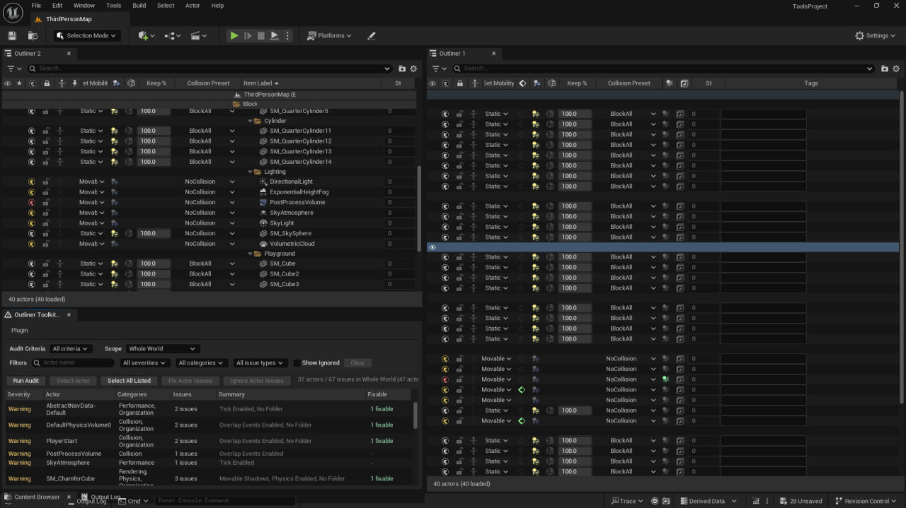

# Outliner Toolkit

Inspect and edit actors directly in the Unreal Editor Scene Outliner. Use the audit panel to find scene setup issues across an entire level or a smaller selection.

## Getting started

For a source installation, copy the complete plugin folder into your project's `Plugins` directory, regenerate project files, and build the Editor target. Enable **Outliner Toolkit** in **Edit > Plugins** and restart when prompted. The ToolsProject configuration targets Unreal Engine 5.5 on Windows.

1. Open **Tools > Outliner Toolkit Audit** in the **Outliner Toolkit** section.
2. Choose a scope such as selected actors, current level, visible actors, or the world.
3. Filter the results by severity or issue type. Select a row to see details, focus the actor, or open its mesh.
4. Apply an available fix or ignore an issue you have reviewed. Use the ignored results filter to restore it later.

## Scene Outliner tools

| Feature | Examples |
| --- | --- |
| Columns | Edit visibility in game, lock state, mobility, tick, collision, shadows, physics, overlap events, Custom Depth, stencil values, and tags. |
| Mesh columns | Inspect or change Nanite settings on the static mesh asset. Other actors sharing that mesh also use the changed asset settings. |
| Filters | Find untagged actors, actors outside folders, invalid mesh assignments, invalid physics mobility, excess material slots, and non-uniform scale. |
| Actor actions | Group or ungroup actors, copy and paste settings, edit label prefixes and suffixes, or toggle common properties across a selection. |

Open **Outliner Toolkit Settings** from the same Tools menu section to adjust component and material slot thresholds, scale tolerance, and issue severity. Run the `OutlinerToolkit` Automation group to check audit rules, result grouping, and settings.
