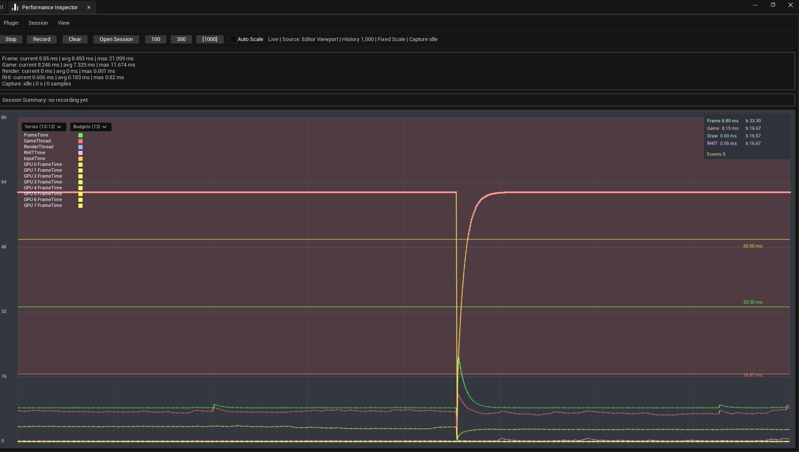

# Performance Inspector

Monitor frame timing in Unreal Editor, record sessions, and compare the results against performance budgets.



## Getting started

Copy the plugin folder that contains `PerformanceInspector.uplugin` into your project's `Plugins` directory. For a source installation, regenerate project files and build the Editor target. Enable **Performance Inspector** and restart when prompted. The ToolsProject configuration targets Unreal Engine 5.5 on Windows.

1. Open **Performance Inspector** from the Level Editor toolbar or press **Shift+Q**.
2. Inspect frame, game thread, render thread, input latency, RHI, and GPU timing. Choose which series to show and set budgets for those metrics.
3. Start a recording, reproduce the scenario, and stop recording. Find the outputs under `Saved/PerformanceCaptures`.
4. Open a saved JSON capture in the panel to zoom, pan, or export a summary of a selected range.

Exports include raw samples, summaries, and event markers in CSV or JSON. Summary PNG export can be enabled in project settings.

## Capture during gameplay

Configure automatic PIE recording under **Project Settings > Plugins > Performance Inspector**. For gameplay-controlled captures, use the **Performance Capture** Blueprint functions or `UPerformanceCaptureSubsystem` in C++ to start and stop a session, add markers, and inspect its report.

Pass these flags to a project launch for a timed capture:

```text
-PerformanceInspectorAutoCapture -PerformanceInspectorCaptureDuration=30
-PerformanceInspectorMinAverageFPS=60 -PerformanceInspectorExitOnComplete
-PerformanceInspectorFailOnThresholdFailure
```

The duration is in seconds. The last flag requests a failing exit code when configured thresholds fail. Match the map, build, and rendering settings across runs when comparing reports.

Run the `PerformanceInspector` Automation group for report and threshold checks.
