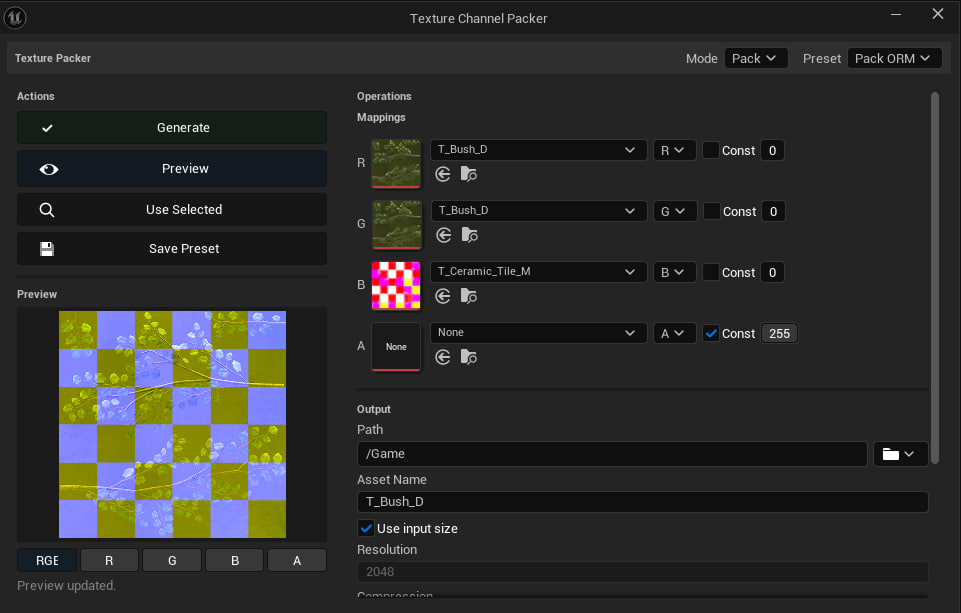

# Texture Channel Packer

Unreal Engine editor plugin for packing, remapping and extracting texture channels.
It reads editor source pixels and creates uniquely named texture assets.

## Requirements and installation

Validated configuration: **Unreal Engine 5.5, Windows x64**. This is an editor-only
plugin. Other engines and platforms have not been validated and are not enabled
in the distribution descriptor.

Close Unreal Editor and copy the complete `TextureChannelPacker` folder into
`<YourProject>/Plugins/`. Reopen the project, enable **Texture Channel Packer** under
**Edit > Plugins**, and restart when prompted. Install only one copy across your
project and engine plugin directories.

A source checkout requires a compatible Visual Studio C++ toolchain and Windows
SDK. Regenerate project files and build the project's Editor target in Development
configuration. A packaged Win64 build contains editor binaries for its matching
engine version.

Open **Tools > Texture Channel Packer** in the **Texture Packing** section. The modeless window remains above the main
editor window while you select textures in the Content Browser.

## Choose an operation

| Operation | Use it to |
| --- | --- |
| **Pack** | Combine channels from several textures, for example AO, roughness, and metallic into one ORM mask. |
| **Repack** | Reorder channels from a packed texture, for example ORM to RMO. |
| **Unpack** | Extract enabled channels into separate grayscale textures. |
| **Copy Channels** | Copy selected channels into a new texture. |

## Workflow

1. Select **Pack**, **Repack**, **Unpack**, or **Copy Channels**.
2. Choose a preset or configure the channel mappings. In Pack, each row can use a
   separate texture and source component. Initial source components are R/G/B/A.
3. Alternatively, select textures in the Content Browser and click **Use Selected**.
   Preset patterns select matching source names. For Repack, mappings share the
   first supplied packed texture.
4. Choose a destination under `/Game`, or an absolute folder inside this project's
   `Content` directory. Enter an asset name and choose output settings.
5. Click **Preview** and inspect RGB or an isolated component. Click **Generate**
   to create and save the output assets.

**Const** replaces a sampled component with a byte value from 0 to 255. Missing RGB
components use zero and missing alpha uses one. Initial alpha is Const 255.

Pack, Repack and Copy Channels all create new assets. They do not overwrite the
input or an existing destination asset; name collisions receive unique names.
Unpack creates one asset per enabled output using its suffix. Its preview displays
the first enabled output. Unpack applies grayscale compression and disables sRGB.

## Presets

Built-in presets include Pack ORM, Repack ORM to RMO and Unpack ORM. Presets retain
channel selections, constants, source patterns, output settings, naming suffixes
and Unpack enabled states. **Save Preset** uses the current asset name as the preset
identifier; saving the same name again replaces it case-insensitively.
Presets are stored in the project's `Config/DefaultEditor.ini`. Make this file
writable before saving; a read-only file produces an error and preserves the
previous preset list. Preview is cleared when inputs or processing settings change;
click **Preview** again to render the updated configuration.

Pattern lists accept commas and semicolons. Matching is case-insensitive and
supports wildcards and substrings, for example `_AO;_Occlusion,AmbientOcclusion`.
The first matching texture is used. Review the populated mappings before generation.

For grayscale AO, roughness and metallic inputs, RGB components normally carry the
same scalar. For colored or previously packed textures, explicitly choose the
required source component; the initial R/G/B selection is not a grayscale conversion.

## Source formats and resizing

Supported input and output source formats:

| Format | Stored components | Precision |
| --- | --- | --- |
| G8 / G16 | One grayscale component | Unsigned 8 / 16 bit |
| R16F / R32F | One scalar component | Floating-point 16 / 32 bit |
| BGRA8 | RGBA | Unsigned 8 bit |
| RGBA16 | RGBA | Unsigned 16 bit |
| RGBA16F / RGBA32F | RGBA | Floating-point 16 / 32 bit |

Single-component inputs supply the scalar to RGB and opaque alpha. Single-component
outputs store the resolved red component. Integer output clamps to [0, 1]; floating
source data can retain values outside that range.

Auto chooses source storage using Float32 > Float16 > UInt16 > UInt8 precedence.
It selects RGBA for packing operations and a single component for Unpack. Mixing
UInt16 and Float16 can reduce integer precision; select a 32-bit float format when
that distinction matters.

**Use input size** uses the first readable input's dimensions. Manual output is
square, between 1 and 16384. CPU resizing uses nearest-neighbor sampling. The Filter
setting controls sampling of the generated asset, not the resizing algorithm.

## Preview and processing limits

Preview shows resolved source channels and output-format quantization in an opaque,
linear BGRA8 image, with a maximum dimension of 512. Isolated channel views display
grayscale. HDR values are clamped for display. Preview does not simulate platform
compression, mip generation or sRGB rendering; inspect the generated asset for those
effects.

Each source, channel and output buffer is checked before allocation and limited to
512 MiB. This is not a limit on total process memory: multiple source channels,
source decompression and Unreal texture compilation may use additional memory.

Processing runs on the game thread. Cancellation is cooperative between inputs,
inside decode blocks and output rows, and before saving. Preview shows a delayed
cancel dialog for longer work. An individual package save is not interrupted midway.

An Unpack failure or cancellation attempts to remove outputs created by that
request. If a file cannot be removed, the error identifies it and the surviving
asset remains available. Existing assets are not part of rollback. This is not a
crash-safe disk transaction, and editor Undo does not undo files already saved.
The destination directory is checked before saving. A later operating-system write
or move failure can still leave an Unreal temporary file in the project's `Saved`
directory; the plugin does not delete arbitrary temporary files owned by the editor.

Inputs must have readable editor source data. UDIM/multi-block and layered sources
are not a supported workflow; processing uses the first source block/layer and mip
zero. Batch grouping, export to image files and color-space conversion are not provided.

## Tests

The separate `TextureChannelPackerTests` editor module organizes tests into Unit,
Integration and UI folders. See [test instructions](Tests/README.md) for coverage and
the full suite runner. Rendered preview tests require a real RHI, not `-NullRHI`.

## License

Distributed under the project's [MIT license](LICENSE).
