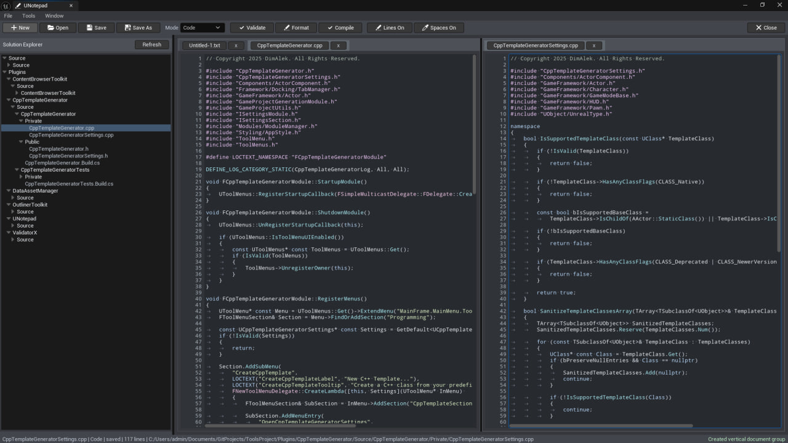

# UNotepad

Edit source and data files in a dockable Unreal Editor tab. Open multiple documents, split the workspace, and browse project sources from the built-in Solution Explorer.

## Getting started

Copy the complete `UNotepad` folder into your project's `Plugins` directory. For a source installation, regenerate project files and build the Editor target. Enable **UNotepad** in **Edit > Plugins** and restart when prompted. The ToolsProject configuration targets Unreal Engine 5.5 on Windows.

Open **Tools > UNotepad** or use the Level Editor toolbar. Create an untitled document, open a file from disk, or double-click a file in the Solution Explorer. Use **Save** or **Save As** to write the document. Unsaved documents prompt on close.

## Choose a document mode

| Mode | Tools |
| --- | --- |
| Text | Plain text editing, search and replace, and go to line. |
| Code | Comment toggling, line duplication and movement, and matching header/source navigation. |
| Verse | Lexical highlighting, Verse line comments, and indentation shortcuts. Build Verse in UEFN. |
| JSON | Syntax validation and formatting. |
| CSV | Parsing, validation, and normalized formatting. |

Use vertical or horizontal splits to work on multiple documents. The editor also supports Undo/Redo, line numbers, whitespace display, and line ending conversion. Open **Project Settings > Plugins > UNotepad** to set font size, tab width, and the extensions shown in Solution Explorer. Add `verse` to an older customized extension list if Verse files are missing.

Run the `UNotepad` Automation group for document and editor service checks.
