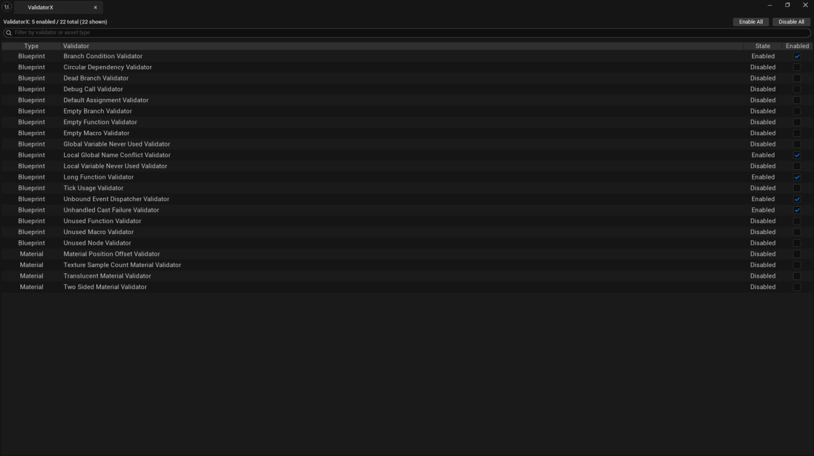

# ValidatorX

Manage additional Blueprint and Material rules for Unreal Editor's Data Validation system.

## Getting started

Copy the complete `ValidatorX` folder into your project's `Plugins` directory. For a source installation, regenerate project files and build the Editor target. Enable **ValidatorX** in **Edit > Plugins** and restart when prompted. The ToolsProject configuration targets Unreal Engine 5.5 on Windows.

1. Open **Tools > Open ValidatorX**.
2. Search the dashboard and enable the rules you want to apply. Use the bulk controls to enable or disable all listed rules. The enabled states are saved to config.
3. Run Unreal's asset validation from the Content Browser and review findings in **Message Log**. Node-specific findings can include links to the Blueprint graph location.

## Rule coverage

| Asset type | Examples |
| --- | --- |
| Blueprint | Unconnected branch conditions and execution paths, debug calls, unused functions and variables, long functions, unhandled cast failures, and unbound dispatchers. |
| Material | World Position Offset, texture sample count, translucent blend modes, and two-sided rendering. |

Rules report findings for review. For example, a two-sided material can be intentional for foliage. Enable the rules that match your project's conventions.

Run the `ValidatorX` Automation group for dashboard state, validation rules, and graph utilities.
