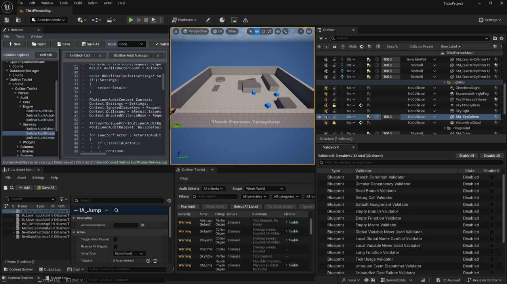
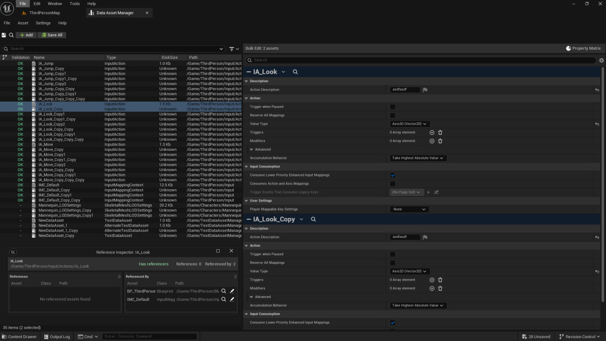
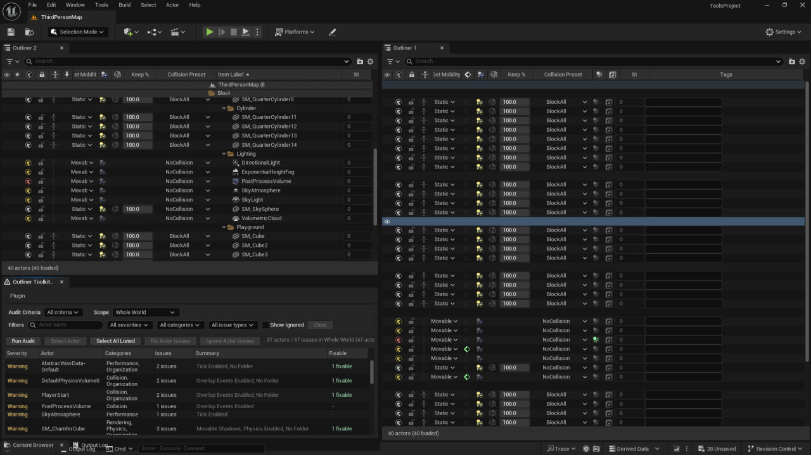
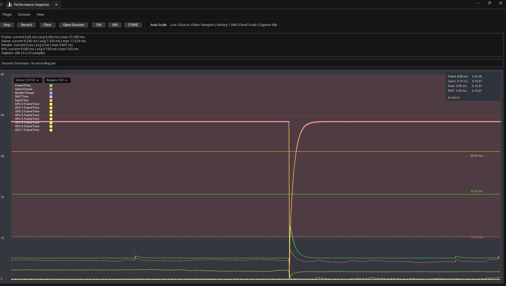
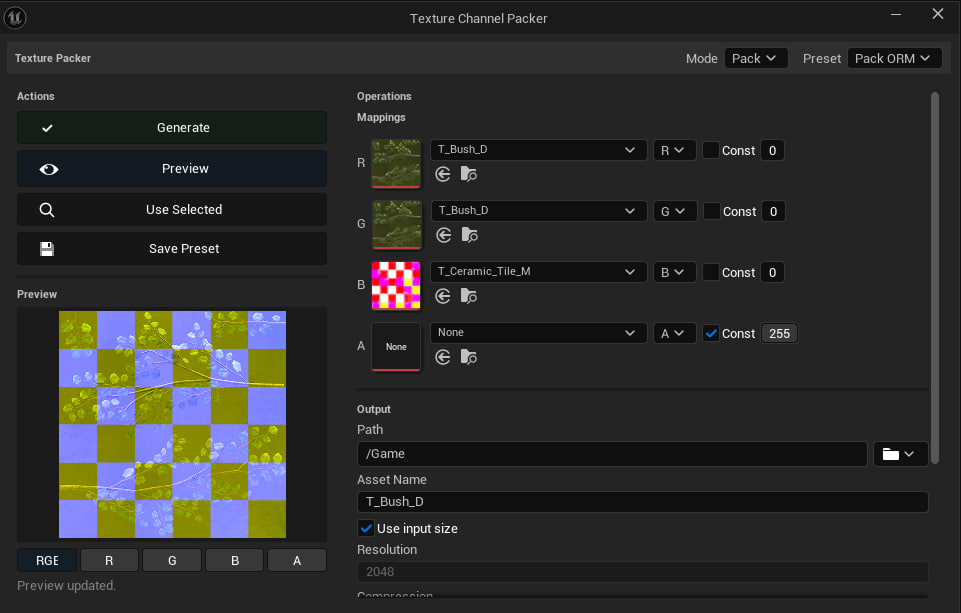

<p align="center">
  
</p>

<h1 align="center">ToolsProject</h1>

<p align="center">
  <strong>A focused collection of Unreal Engine 5.5 editor tools for faster, cleaner production workflows.</strong>
</p>

<p align="center">
  Nine standalone plugins for content management, editor productivity, validation, performance analysis, and graph organization.
</p>

<p align="center">
  
  
  
  <a href="LICENSE"></a>
</p>

<p align="center">
  <a href="#quick-start">Quick Start</a> •
  <a href="#the-toolkit">The Toolkit</a> •
  <a href="Docs/Plugins.md">Full Documentation</a> •
  <a href="#testing">Testing</a>
</p>

---

## One workspace. Nine focused tools.

ToolsProject brings everyday Unreal Editor improvements into one coherent workspace. Use the complete project or take individual plugins into your own toolchain.

| Tool | Focus | Highlights |
| --- | --- | --- |
| **CppTemplateGenerator** | C++ workflow | Create native classes from a configurable set of approved parent templates. |
| **ContentBrowserToolkit** | Content audit | Search and triage assets with production-oriented Content Browser filters. |
| **DataAssetManager** | Data Assets | Browse, filter, validate, compare, and maintain Data Assets in bulk. |
| **OutlinerToolkit** | Scene organization | Add useful Outliner columns, actor batch actions, filters, and world audits. |
| **PerformanceInspector** | Performance | Capture frame metrics, inspect live graphs, add markers, and export reports. |
| **TextureChannelPacker** | Textures | Pack, repack, unpack, and preview texture channels through reusable presets. |
| **UNotepad** | Editing | Edit text, source code, JSON, CSV, and Verse without leaving Unreal Editor. |
| **ValidatorX** | Validation | Manage project validators from a searchable Data Validation dashboard. |
| **WireBundle** | Graphs | Organize Blueprint and Material wires with native reroute bundles. |

<p align="center">
  <a href="Docs/Plugins.md"><strong>Explore the complete plugin guide</strong></a>
</p>

## A closer look

<table>
  <tr>
    <td width="50%">
      <a href="Docs/Plugins.md#dataassetmanager"></a>
    </td>
    <td width="50%">
      <a href="Docs/Plugins.md#outlinertoolkit"></a>
    </td>
  </tr>
  <tr>
    <td width="50%">
      <a href="Docs/Plugins.md#performanceinspector"></a>
    </td>
    <td width="50%">
      <a href="Docs/Plugins.md#texturechannelpacker"></a>
    </td>
  </tr>
</table>

## Quick Start

### Requirements

- Unreal Engine **5.5**
- Windows
- Visual Studio toolchain compatible with Unreal Engine 5.5

### Open the workspace

```powershell
git clone https://github.com/HexForgeDeveloper/Tools-Project.git
```

1. Open `ToolsProject.uproject` in Unreal Engine 5.5.
2. Build the `ToolsProjectEditor` target in the **Development Editor** configuration.
3. Launch the project and open the required tools from the editor menus or toolbar.

Each plugin is self-contained under [`Plugins/`](Plugins/). See the [plugin guide](Docs/Plugins.md) for entry points, settings, controls, and limitations.

### Use individual plugins

The plugins are also synchronized to the separate [Tools-Plugins](https://github.com/HexForgeDeveloper/Tools-Plugins) repository. Copy the required plugin into your project's `Plugins` directory, regenerate project files, and build your editor target.

## Testing

The repository includes dedicated automation test modules and a project-wide test runner:

```powershell
powershell -ExecutionPolicy Bypass -File DevOps/Test-Project.ps1
```

The script builds `ToolsProjectEditor`, discovers the supported headless test suites, runs them, and writes reports to `Saved/CI`.

## Project Status

ToolsProject is under active development. The editor tools are usable, but APIs, UI details, and validation rules may continue to evolve.

Contributions are welcome. Keep changes focused and run the relevant automation tests for modified plugins.

## License

Released under the [MIT License](LICENSE).
